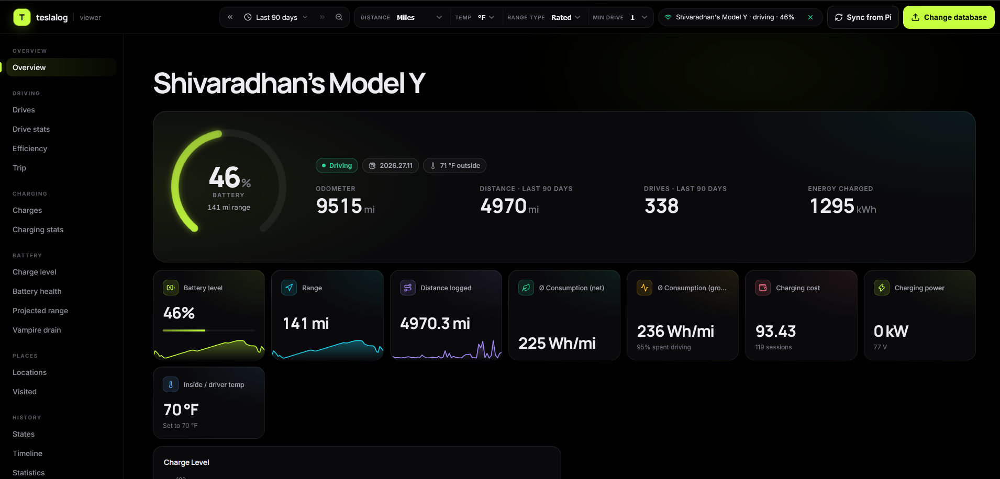

# teslalog

[](https://goreportcard.com/report/github.com/shivardev/tessieWatcher)
[](LICENSE)
[](go.mod)
[](docs/reference.md#building)

### [Open the live frontend →](https://shivardev.github.io/tessieWatcher/)

The hosted viewer can open a teslalog SQLite database or a TeslaMate
plain-text PostgreSQL dump. Processing happens locally in your browser; your
database is not uploaded.

> **A private Tesla driving and charging history that fits on a Pi Zero 2 W.**

teslalog turns your Tesla's raw telemetry into a searchable history of where
you drove, how efficiently you drove, what it cost to charge, and how the
battery is changing over time.

It runs as **one small Go process with one SQLite file**. Open the included web
app to explore 19 dashboards, routes, charges, efficiency, battery health,
vampire drain, mileage, and more.

<p align="center">
  
</p>

<p align="center"><em>The browser-powered overview: live state plus driving, charging, efficiency, and battery history.</em></p>

## What you can see

- Every drive, including its route, speed, power, elevation, temperatures,
  tyre pressure, energy use, and start/end battery level.
- Every AC or DC charging session, with energy added, time, location, and real
  cost rules for home, work, paid chargers, session fees, or free Supercharging.
- Long-term trends such as efficiency, battery health, projected range,
  vampire drain, mileage, visited places, and vehicle states.
- A focused drive-details view with the route and telemetry for one trip.

The Pi does not run a dashboard engine. It serves a static React app and the
data; your browser runs the SQLite queries and renders the charts. That keeps
CPU and memory use on the Pi low and makes the dashboard feel like a normal
local web app.

## Try the dashboard with sample data

Open the **[hosted frontend](https://shivardev.github.io/tessieWatcher/)** and
select **Explore the demo** to load a sample Tesla immediately. You can also
open your own teslalog database or TeslaMate dump. To run the same demo locally:

```sh
cd frontend
npm install
npm run dev
```

Open the printed local URL and select **Explore the demo**. The generated
sample stays in your browser; it is not uploaded anywhere.

### Already have TeslaMate data?

Open a **plain-text TeslaMate `pg_dump`** in the same viewer. It converts the
dump to an in-memory SQLite database and builds all 19 dashboards locally in
your browser. The file is never uploaded, and private token tables are ignored.

Use PostgreSQL's plain format when creating the dump:

```sh
pg_dump --format=plain --no-owner --no-privileges teslamate > teslamate.sql
```

Then choose **Open database** and select `teslamate.sql`. Custom-format
`PGDMP` backups need to be exported as plain SQL first.

---

## Why I built it

TeslaMate is excellent, already runs on Raspberry Pis, and can do much more
than this project. I wanted a deliberately narrower logger that would run
comfortably on the smaller **Raspberry Pi Zero 2 W with 512 MB of RAM**.

The main difference is where the work happens. A standard TeslaMate setup
uses PostgreSQL and Grafana alongside the logger. teslalog writes directly to
SQLite and moves dashboard queries and chart rendering into the visitor's
browser. The Pi is left to do the important part: carefully collect and store
the car's data.

That trade makes teslalog smaller and simpler, but it is not a drop-in
replacement for everything TeslaMate provides. It does not currently offer
TeslaMate's multi-car support, Home Assistant/MQTT integration, translations,
plugin ecosystem, maturity, or large community. Choose TeslaMate when those
matter; choose teslalog when one car, very small hardware, and minimal
infrastructure are the priority.

The project has three promises:

| | Promise | What it means |
|---|---|---|
| 😴 | **Let the car sleep** | It never wakes the car on its own and stops polling when the car is idle, so it causes no phantom battery drain. |
| 🔒 | **Your data stays yours** | Everything lives in a file on your own device. No cloud account, no telemetry, no third-party upload. |
| 🪶 | **Tiny and boring to run** | One binary with no dependencies, sized for a Pi Zero 2 W (512 MB RAM). Updates itself with one command. |

## Everything included

**Logging and vehicle care**

- Sleep-aware polling that suspends itself when the car is idle and never
  wakes the car automatically. A wake command exists, but only for you to run.
- Automatic drive and charging detection using the Owner API and live vehicle
  stream.
- GPS route, speed, power, elevation, odometer, range, battery level,
  temperatures, climate state, tyre pressure, and software-update history.
- Read-only operation: no climate, lock, charging, or other vehicle controls.

**Dashboards and access**

- A built-in, mobile-friendly viewer with 19 dashboards: Overview, Drives,
  Drive Stats, Efficiency, Trip, Charges, Charging Stats, Charge Level,
  Battery Health, Projected Range, Vampire Drain, Locations, Visited, States,
  Timeline, Statistics, Mileage, Updates, and Database Information.
- Per-drive detail pages with a route map and trip telemetry.
- A lightweight live status page showing vehicle state, battery, range,
  today's driving, the last charge, recent drives, and service activity.
- One-click safe database download, plus CSV export for drives and charges.
- Optional ready-made Grafana dashboards if you already run Grafana.

**Locations and charging costs**

- Named circular geofences for places such as home, work, and regular chargers.
- Optional reverse-geocoding for addresses; it is off by default for privacy.
- A different charging price for each location: per kWh, per minute, a flat
  session fee, free locations, and an option for free Tesla Supercharging.

**Your data and reliability**

- One local SQLite file, with no hosted account or required cloud service.
- Safe online backups while logging continues, automatic retention, on-demand
  backups, and optional off-device copies through configured rclone targets.
- Self-updates, Linux systemd installation, Windows support, Docker as an
  option, and 32-bit or 64-bit Raspberry Pi builds.
- Optional idle-only incremental sync to a home-server PostgreSQL archive. The
  Pi keeps collecting if that server is offline and catches up later.
- Browser-managed sync and geofence settings, including sync health and queued
  manual sync requests.

**TeslaMate interoperability**

- Open a TeslaMate plain-text PostgreSQL dump directly in the web viewer. It is
  converted and visualized entirely inside the browser without an upload.
- Import years of history from a live TeslaMate PostgreSQL database or an old
  dump into teslalog's SQLite database with [`teslamate-import/`](teslamate-import/).
  Existing and imported vehicles are matched by VIN.
- Feed teslalog data into a separate PostgreSQL database for use with
  TeslaMate's original Grafana dashboards via [`teslamate-sync/`](teslamate-sync/).
  It never modifies the real `teslamate` database.
- A TeslaMate-aligned data model and polling behavior so drives, charges, and
  calculated costs can be compared meaningfully between the two projects.

## How it compares

[TeslaMate](https://github.com/teslamate-org/teslamate) and
[TeslaLogger](https://github.com/bassmaster187/TeslaLogger) are the two
established self-hosted loggers. Both are mature and well supported; teslalog
trades their breadth for a much smaller footprint.

| | **teslalog** | **TeslaMate** | **TeslaLogger** |
|---|---|---|---|
| Written in | Go (one static binary) | Elixir | C# (Mono) |
| Storage | One SQLite file (optional PostgreSQL mirror) | PostgreSQL | MariaDB |
| Dashboards | Built-in web viewer (Grafana optional) | Grafana | Grafana + built-in web page |
| What you run | 1 process | 4 containers: app, PostgreSQL, Grafana, MQTT broker | Logger, MariaDB, Grafana |
| Raspberry Pi | 32- and 64-bit OS; built for small boards (512 MB, Pi Zero 2 W class) | 64-bit OS only, 1 GB RAM minimum, 2 GB recommended | Pi 3B, 3B+, 4B (ready-made image), Docker, Synology |
| Docker needed | No (optional) | Yes for the standard install (NixOS and manual installs also documented) | No with the Pi image; yes otherwise |
| Tesla API | Owner API + streaming (unofficial) | Owner API + streaming (unofficial) | Supports Tesla's official Fleet API |
| Home Assistant / MQTT | No | Yes, MQTT | MQTT client |
| Interface languages | English | 19 | 11 |
| Imports from | TeslaMate (`pg_dump`) | TeslaFi, tesla-apiscraper | TeslaFi, TeslaMate |
| License | MIT | AGPL-3.0 | GPL-3.0 |
| Maturity | New, one maintainer | Years of releases, large community | Years of releases, large community |

**Choose TeslaMate or TeslaLogger if** you want Home Assistant/MQTT
integration, several cars in one install (TeslaMate), a translated
interface, the official Fleet API (TeslaLogger), or a long track record. **Choose teslalog
if** you want the smallest possible setup: one binary and one file on a
small or 32-bit Raspberry Pi, with no database server, no Grafana and no
Docker.

Details for TeslaMate and TeslaLogger come from their own READMEs and
install docs as of October 2026.

## How it fits together

```
           Tesla (Owner API + streaming)
                       │
                       ▼
   ┌────────────────────────────────────────┐
   │  teslalog on a Raspberry Pi (or any PC) │
   │  · sleep-aware polling                  │
   │  · writes tesla.db (SQLite)             │
   │  · web viewer on :8083                  │
   └───────────────┬────────────────────────┘
                   │  optional, only when the car is idle
                   ▼
   ┌────────────────────────────────────────┐
   │  Home server (Docker): PostgreSQL       │
   │  full history + the same viewer on :8085│
   └────────────────────────────────────────┘
```

## Quick start (Raspberry Pi)

1. Flash Raspberry Pi OS Lite, enable SSH and Wi-Fi, then on the Pi run:

   ```sh
   curl -fsSL https://raw.githubusercontent.com/shivardev/tessieWatcher/master/deploy/quick-install.sh | sudo bash
   ```

2. Log in to your Tesla account (one time):

   ```sh
   sudo -u teslalog teslalog auth -config /etc/teslalog/config.toml
   ```

   It prints a Tesla login link. Open it on any device, sign in, and paste
   the result back. [Login help →](docs/reference.md#authentication)

3. Start it:

   ```sh
   sudo systemctl enable --now teslalog
   ```

4. Open `http://<your-pi>:8083` from any device on your home network.

Not on a Pi? The same binary runs on any Linux PC or Windows, and there is
a Docker setup too — see [Building](docs/reference.md#building) and
[Running with Docker](docs/reference.md#running-with-docker).

## Looking at your data

| Option | Where | Best for |
|---|---|---|
| **Status page** | `http://<pi>:8083` | Battery, range, today's drives, last charge, one-click database download |
| **Dashboard viewer** | `http://<pi>:8083/app/` | The full set of 19 charts and tables |
| **Home server viewer** | `http://<server>:8085/app/` | Your complete history, after setting up sync |
| **Open a file** | The viewer's _Open database_ button | Exploring a downloaded `.db` file or a TeslaMate `pg_dump`, entirely in your browser |
| **Grafana** | [`grafana/`](grafana/) | Prebuilt Grafana dashboards, if you already use it |
| **CSV** | `teslalog export drives` | Spreadsheets and scripts |

## Everyday commands

```sh
teslalog status          # today's drives and the last charge
teslalog backup          # take a backup now
teslalog export drives   # write drives to CSV  (also: export charges)
teslalog sync            # push pending rows to the home server now
teslalog wake            # wake the car — only ever done when you ask
sudo teslalog update     # update to the latest release
```

When deploying current source directly from a Windows development PC, one
command detects the Pi architecture, builds the viewer and Go binary, copies
it, installs it, restarts the service, and verifies the result:

```powershell
./deploy/update-pi.ps1
```

Full list and flags: [CLI reference](docs/reference.md#cli-reference).

## Optional: sync to a home server

Keep the Pi small and put the full archive on a PC:

1. On the PC, copy `deploy/postgres.env.example` to `.env`, set the secrets,
   then run `docker compose -f docker-compose.postgres.yml up -d --build`.
   For later updates, run `./deploy/update.ps1`; it pulls the latest commit,
   detects the running Docker stack, rebuilds the server and embedded viewer,
   and waits for a healthy container.
2. On the Pi, open `http://<pi>:8083/admin/sync`, enter the server address
   and press **Test, link, and sync now**.

Syncing only happens while the car is idle or asleep. If the server is
offline, nothing is lost — changes wait on the Pi and are sent later.
[Full guide →](docs/reference.md#optional-postgresql-synchronization)

## Privacy & safety

- **Read-only.** teslalog never sends commands to your car (no climate,
  locks or charging control). The only wake call is the manual
  `teslalog wake`.
- **Your password is never stored**, only Tesla's login tokens, in a file
  only the service can read.
- **Keep the status page on your home network.** It has no login, and the
  database is a record of everywhere the car has been. Do not port-forward
  it. If you publish the home server, keep its token on and put it behind
  something like Cloudflare Access.
- **Location lookups are off by default.** Turning on reverse-geocoding
  sends coordinates to a geocoding service, so it is opt-in.

## What it is not

- Not a remote control app — it only watches.
- Not a hosted service — you run it, you own the data.
- Not an official Tesla product. It uses the same unofficial API as
  TeslaMate, which Tesla can change at any time. The Tesla client is kept
  in one isolated package so it can be swapped out without touching your
  data.

## Project layout

```
cmd/teslalog/        the CLI (auth, start, status, sync, export, update…)
internal/tesla/      Tesla login, Owner API and streaming client
internal/vehicle/    the sleep-aware state machine (pure logic, fully tested)
internal/storage/    SQLite schema and queries
internal/runner/     wires everything into `teslalog start`
internal/portal/     status page, JSON API, serves the viewer at /app
internal/cloudsync/  optional Pi → home-server replication
internal/pgserver/   the PostgreSQL-backed server for the home PC
frontend/            the dashboard viewer (React + TypeScript + Vite)
grafana/             optional Grafana dashboards
deploy/              install, cross-build and Docker helpers
```

## Development

```sh
go test ./...                      # backend tests, including a simulated car
cd frontend && npm install
npm run dev                        # viewer at http://localhost:5173
npm test && npm run build          # frontend checks
```

No C compiler needed — SQLite runs as pure Go via WebAssembly, so
cross-compiling for the Pi is just `bash deploy/cross-build.sh`.

## Learn more

- **[Reference manual](docs/reference.md)** — sleep behavior, data model and
  TeslaMate parity, every config option, backups, troubleshooting.
- [Viewer README](frontend/README.md) — how the dashboard app works.
- [Grafana setup](grafana/README.md).
- [Bug log](docs/BUG-LOG.md) — real issues found and how they were fixed.

## Credits

Built on the shoulders of [TeslaMate](https://github.com/teslamate-org/teslamate):
its data model, polling intervals and charging-cost rules are the reference
this project is checked against. If you have the hardware for TeslaMate, it
is a fantastic choice; teslalog is for when you don't.

## License

[MIT](LICENSE)
